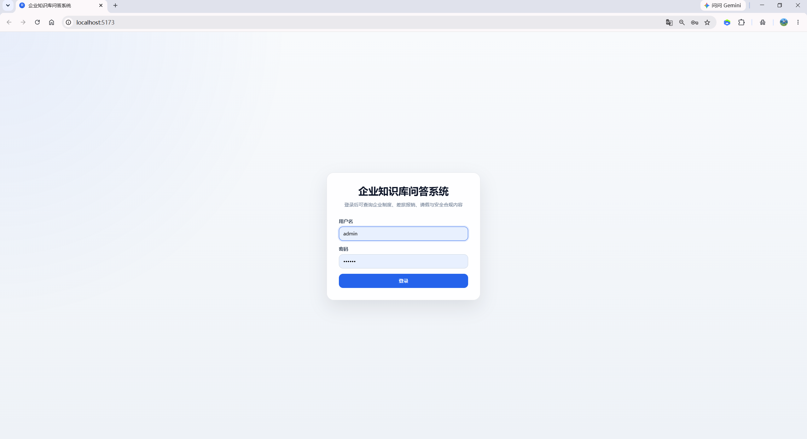
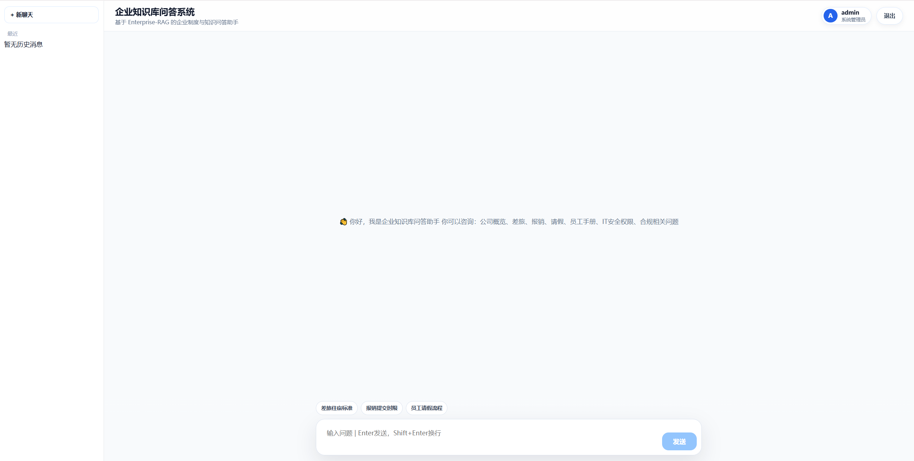
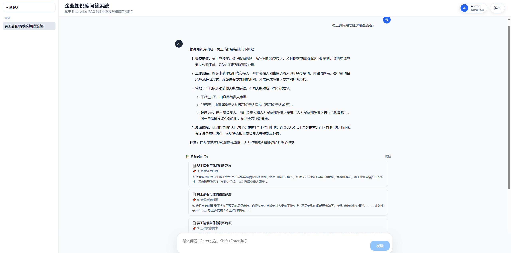
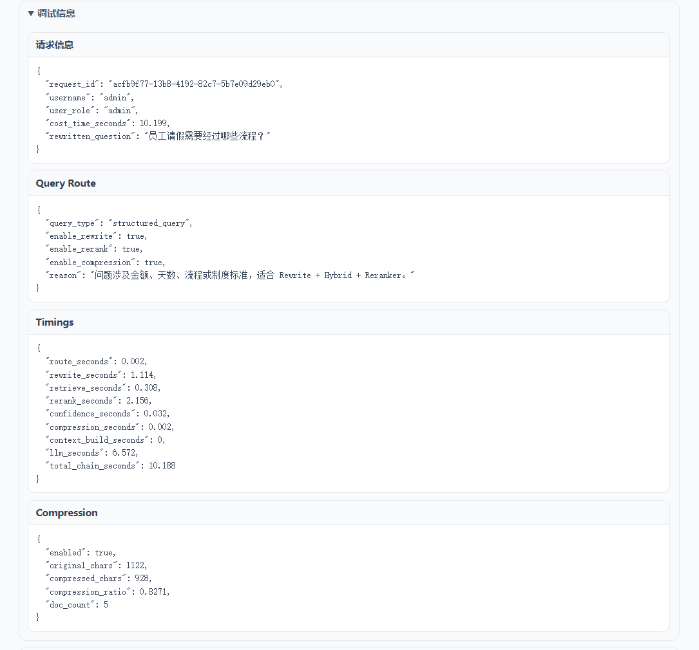
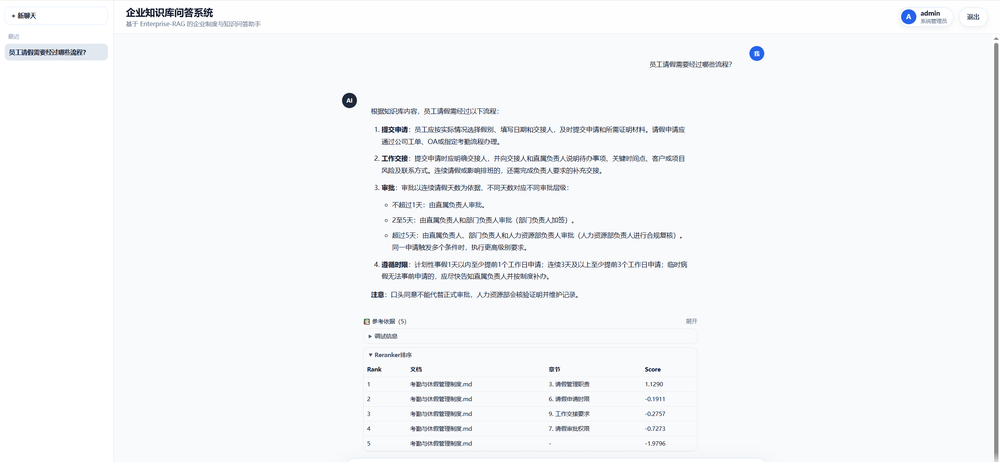
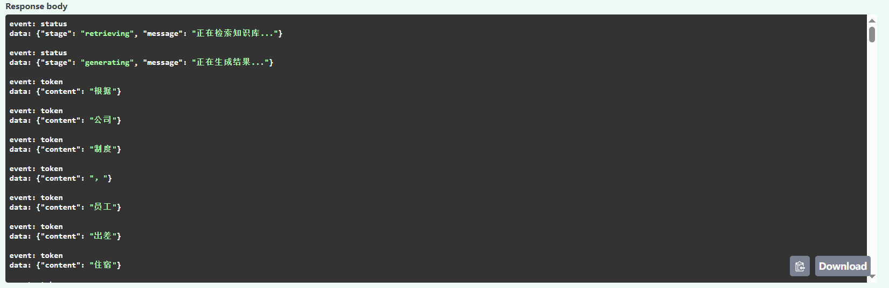

# Enterprise-RAG 企业级知识库问答系统

Enterprise-RAG 是一个面向企业内部制度与业务文档的全栈 RAG 知识库问答系统。

项目以真实企业知识管理场景为背景，完整实现了文档处理、混合检索、重排、查询改写、低置信度拒答、文档权限隔离、多轮会话、SSE 流式输出、API 服务和 React 前端展示。

本项目并非简单的“大模型套壳”，而是一套具备检索增强、权限控制、答案溯源、测试评估和部署能力的企业级 RAG 应用。

---

## 1. 项目功能

系统可以回答企业员工对内部制度的自然语言问题，例如：

- 员工出差住宿标准是什么？
- 报销需要在多久内提交？
- 员工请假需要经过哪些审批？
- 公司全称、简称和英文名称是什么？
- HR 内部的调薪流程是什么？
- 财务审核报销时需要检查哪些内容？
- 研发账号权限如何申请？
- 合同风险应经过哪些审核流程？

当知识库中没有足够依据时，系统会返回统一拒答，而不是使用外部知识猜测答案。

---

## 2. 核心能力

### 2.1 文档处理

- 递归加载 Markdown 企业文档
- 保留文件名、路径、文档类型等 Metadata
- Markdown 文本清洗
- 按一级、二级标题进行结构化切分
- 按 `chunk_size` 和 `chunk_overlap` 进行二次递归切分
- 自动生成 `chunk_id`、`chunk_index` 和字符统计
- 输出 `chunks.jsonl` 供 BM25 检索使用
- 使用 BGE-M3 生成 Dense Vector
- 将向量写入 Milvus Collection

### 2.2 检索增强

- Milvus Dense Vector Search
- BM25 Keyword Search
- Dense + BM25 Hybrid Search
- RRF 融合排序
- BGE Reranker 精排
- Query Rewrite 查询改写
- Query Router 动态控制改写和重排策略
- Context Compression 上下文压缩
- Confidence Guard 低置信度判断
- 无答案统一拒答
- 引用来源和原文片段返回

### 2.3 用户与权限

- JWT 登录认证
- 基于角色的文档级权限控制
- 普通员工只能访问公共文档
- 部门用户可以访问公共文档和本部门私有文档
- 部门之间禁止跨权限访问
- 管理员可以访问全部文档
- 权限过滤在检索前执行，避免越权文档进入大模型上下文
- 普通用户不返回内部调试数据
- 管理员可以查看路由、耗时、压缩和重排信息

### 2.4 会话与流式输出

- Redis 保存聊天会话
- 支持创建、读取和删除会话
- 支持多轮对话历史
- 首条问题自动生成会话标题
- SSE 真流式返回大模型增量文本
- 前端实时显示“正在检索知识库”和“正在生成结果”
- 流式返回引用来源与最终响应数据

### 2.5 前端展示

- React + TypeScript + Vite
- 登录页面
- JWT 登录状态保存
- 多角色身份展示
- 左侧历史会话列表
- 新建与删除会话
- Markdown 内容渲染
- GFM 表格渲染
- 引用来源折叠展示
- 管理员调试信息展示
- 管理员 Reranker 排序展示
- SSE 流式打字效果
- 示例问题快捷输入

### 2.6 工程化能力

- FastAPI 分层架构
- Route、Service、RAG Chain 职责分离
- Pydantic 请求与响应校验
- 未定义字段禁止传入
- 统一异常响应
- Request ID 请求追踪
- 请求日志中间件
- 健康检查与就绪检查
- Docker Compose 服务编排
- 单元测试、Smoke Test 和 API 集成测试
- 检索与 RAG 评估报告输出

---

## 3. 系统架构

```
flowchart TD
    A[React 前端] --> B[FastAPI API]

    B --> C[JWT 身份认证]
    C --> D[角色权限过滤]
    D --> E[ChatService 业务编排]

    E --> F[Redis 会话历史]
    E --> G[EnterpriseRAGChain]

    G --> H[Query Router]
    H --> I[Query Rewrite]

    I --> J[Hybrid Retriever]
    J --> K[Milvus Dense Search]
    J --> L[BM25 Search]

    K --> M[RRF 融合排序]
    L --> M

    M --> N[BGE Reranker]
    N --> O[Confidence Guard]
    O --> P[Context Compression]
    P --> Q[LLM 生成答案]

    Q --> R[SSE / JSON 响应]
    R --> A
```

Milvus 依赖：

```text
Milvus
├── Etcd：保存 Milvus 元数据
└── MinIO：保存向量和索引相关对象数据
```

---

## 4. RAG 主链路

```text
用户问题
    ↓
JWT 认证
    ↓
根据角色生成文档权限过滤条件
    ↓
读取 Redis 历史对话
    ↓
Query Router 查询分类
    ↓
Query Rewrite 查询改写
    ↓
Hybrid Search
    ├── Milvus Dense Vector Search
    └── BM25 Keyword Search
    ↓
RRF 融合排序
    ↓
BGE Reranker 精排
    ↓
Confidence Guard 置信度判断
    ├── 低置信度：直接拒答
    └── 置信度通过：继续执行
    ↓
Context Compression
    ↓
LLM 根据知识库上下文生成答案
    ↓
保存 Redis 会话历史
    ↓
返回答案、引用来源和调试信息
```

---

## 5. 技术栈

| 模块 | 技术 |
|---|---|
| 后端框架 | FastAPI |
| 前端框架 | React、TypeScript、Vite |
| RAG 框架 | LangChain |
| 大语言模型 | DeepSeek，可通过配置替换 |
| Embedding | BAAI/bge-m3 |
| Dense 向量库 | Milvus |
| 关键词检索 | BM25 |
| 混合检索 | Dense + BM25 + RRF |
| Reranker | BAAI/bge-reranker-v2-m3 |
| 会话存储 | Redis |
| 身份认证 | JWT |
| 文档格式 | Markdown |
| 容器化 | Docker Compose |
| 前端 Markdown | react-markdown、remark-gfm |
| 测试 | Python 单元测试、Smoke Test、requests API 集成测试 |

---

## 6. 知识库与权限模型

知识库按照公共文档和部门私有文档组织：

```text
data/raw/markdown/
├── public/            # 全体员工可访问
├── hr/                # HR 私有文档
├── finance/           # 财务私有文档
├── engineering/       # 研发私有文档
├── administration/    # 行政私有文档
├── legal/             # 法务私有文档
└── management/        # 管理层私有文档
```

### 权限矩阵

| 角色 | 公共文档 | 本部门文档 | 其他部门文档 | 调试信息 |
|---|---:|---:|---:|---:|
| `employee` | 是 | 否 | 否 | 否 |
| `hr` | 是 | 是 | 否 | 否 |
| `finance` | 是 | 是 | 否 | 否 |
| `engineering` | 是 | 是 | 否 | 否 |
| `administration` | 是 | 是 | 否 | 否 |
| `legal` | 是 | 是 | 否 | 否 |
| `management` | 是 | 是 | 否 | 否 |
| `admin` | 是 | 是 | 是 | 是 |

正常问答时，前端不需要指定文件名：

```json
{
  "metadata_filter": null
}
```

系统会根据当前 JWT 中的角色自动生成允许访问的文档范围。

手动指定 `metadata_filter.source` 主要用于：

- Swagger 权限测试
- 限定单个文档检索
- 管理员调试

---

## 7. 项目结构

```text
enterprise-rag/
├── api/
│   ├── auth/                   # 用户、密码校验、JWT
│   ├── core/                   # 日志、异常、Redis、请求追踪
│   ├── routes/                 # 登录、问答、SSE、会话接口
│   ├── schemas/                # Pydantic 请求和响应模型
│   ├── services/               # API 层会话服务
│   ├── access_control.py       # 文档权限控制
│   ├── dependencies.py         # FastAPI 依赖注入
│   └── main.py                 # FastAPI 应用入口
├── chains/
│   ├── confidence_guard.py     # 低置信度判断
│   └── rag_chain.py            # RAG 主链路
├── compressor/
│   └── context_compressor.py   # 上下文压缩
├── config/
│   └── settings.py             # 项目配置
├── data/
│   ├── raw/markdown/           # 原始企业文档
│   ├── processed/              # chunks.jsonl
│   └── eval/                   # 评估报告
├── embeddings/
│   └── bge_embedding.py        # BGE-M3 Embedding
├── eval/                       # RAG 评估代码
├── frontend/
│   ├── src/api/                # 前端 API 与 SSE 客户端
│   ├── src/assets/             # Markdown 样式等资源
│   ├── src/components/         # 通用组件
│   ├── src/pages/              # 登录和聊天页面
│   └── src/types/              # TypeScript 类型
├── loader/
│   └── markdown_loader.py      # Markdown 加载器
├── pipelines/
│   └── rag_pipeline.py         # RAG 组件组装
├── reranker/
│   └── bge_reranker.py         # BGE Reranker
├── retriever/
│   ├── bm25_retriever.py       # BM25 检索
│   ├── hybrid_retriever.py     # Hybrid Search
│   ├── milvus_retriever.py     # Milvus Dense 检索
│   └── query_router.py         # Query Router
├── rewriter/
│   └── query_rewriter.py       # Query Rewrite
├── scripts/                    # 数据与 Milvus 检查脚本
├── services/
│   ├── chat_service.py         # 问答业务编排
│   └── redis_service.py        # Redis 服务封装
├── splitter/
│   └── markdown_splitter.py    # Markdown 切分
├── tests/                      # 单元、Smoke 和集成测试
├── vectorstore/
│   └── milvus_store.py         # Milvus 构建与连接
├── build_database.py           # 知识库构建入口
├── docker-compose.yaml
├── requirements.txt
└── README.md
```

---

## 8. 环境要求

推荐环境：

- Python 3.11+
- Node.js 20+
- Docker Desktop
- Docker Compose
- 8 GB 以上内存
- 可用的 DeepSeek API Key
- CUDA GPU 可选

没有 GPU 时，可将 Embedding 和 Reranker 配置为 CPU 模式，但首次加载和推理速度会更慢。

---

## 9. 环境变量

复制示例配置：

```powershell
Copy-Item .env.example .env
```

Linux 或 macOS：

```bash
cp .env.example .env
```

常用配置示例：

```env
# LLM
DEEPSEEK_API_KEY=your_deepseek_api_key

# JWT
JWT_SECRET_KEY=change_me

# Milvus
MILVUS_URI=http://127.0.0.1:19530
MILVUS_COLLECTION_NAME=enterprise_rag
MILVUS_DROP_OLD=true

# Redis
REDIS_HOST=127.0.0.1
REDIS_PORT=6379

# Embedding
EMBEDDING_MODEL_NAME=BAAI/bge-m3
EMBEDDING_DEVICE=cuda

# 调试日志
RAG_DEBUG=false
```

完整配置项以以下文件为准：

```text
.env.example
config/settings.py
docker-compose.yaml
```

请勿将真实 `.env`、API Key、JWT Secret 或生产密码提交到 Git。

---

## 10. 本地开发启动

### 10.1 创建虚拟环境

```powershell
python -m venv .venv
.\.venv\Scripts\Activate.ps1
```

安装依赖：

```powershell
pip install -r requirements.txt
```

### 10.2 启动基础服务

```powershell
docker compose up -d etcd minio milvus redis
```

检查状态：

```powershell
docker compose ps
```

### 10.3 构建知识库

首次运行或修改文档后执行：

```powershell
python build_database.py
```

该命令会完成：

```text
加载 Markdown
→ 文本清洗
→ 文档切分
→ 生成 chunks.jsonl
→ 加载 BGE-M3
→ 写入 Milvus
```

### 10.4 启动 FastAPI

```powershell
uvicorn api.main:app --reload
```

访问地址：

| 功能 | 地址 |
|---|---|
| Swagger 文档 | `http://127.0.0.1:8000/docs` |
| OpenAPI | `http://127.0.0.1:8000/openapi.json` |
| Health | `http://127.0.0.1:8000/health` |
| Readiness | `http://127.0.0.1:8000/readiness` |

### 10.5 启动前端

打开新的终端：

```powershell
cd frontend
npm install
npm run dev
```

前端地址：

```text
http://localhost:5173
```

生产构建检查：

```powershell
npm run build
```

---

## 11. Docker Compose 启动

启动基础设施和 API：

```powershell
docker compose up -d etcd minio milvus redis api
```

查看容器状态：

```powershell
docker compose ps
```

查看 API 日志：

```powershell
docker compose logs -f api
```

停止服务：

```powershell
docker compose down
```

如需同时删除数据卷：

```powershell
docker compose down -v
```

> 删除数据卷会清除 Milvus、MinIO、Etcd 和 Redis 中的数据，请谨慎执行。

当前 Compose 主要负责基础设施和 API。React 前端可使用 `npm run dev` 或 `npm run build` 单独运行。

详细说明见：

```text
docs/docker_runbook.md
```

---

## 12. API 接口

### 12.1 健康检查

```http
GET /health
```

用于确认 FastAPI 服务是否存活。

### 12.2 就绪检查

```http
GET /readiness
```

用于检查：

- Redis
- RAG Chain
- Retriever
- Dense Retriever
- Milvus 轻量检索

### 12.3 登录

```http
POST /auth/login
```

请求示例：

```json
{
  "username": "say",
  "password": "123456"
}
```

返回 JWT Token。

### 12.4 创建会话

```http
POST /chat/session/new
```

### 12.5 获取会话列表

```http
GET /chat/sessions
```

### 12.6 获取会话消息

```http
GET /chat/session/{session_id}
```

### 12.7 删除会话

```http
DELETE /chat/session/{session_id}
```

### 12.8 普通问答

```http
POST /chat
```

请求示例：

```json
{
  "question": "员工出差住宿标准是什么？",
  "session_id": "通过 /chat/session/new 获取",
  "retrieve_top_k": 6,
  "rerank_top_k": 3,
  "enable_rewrite": true,
  "enable_rerank": true,
  "enable_compression": true,
  "metadata_filter": null
}
```

普通用户响应包含：

- 用户问题
- 最终答案
- 引用来源
- 当前用户和角色
- 请求 ID
- 总耗时

管理员额外返回：

- 改写后的问题
- Query Router 信息
- 各阶段耗时
- Context Compression 信息
- Reranker 分数

### 12.9 SSE 流式问答

```http
POST /chat/stream
```

事件顺序：

```text
status  → 正在检索知识库
status  → 正在生成结果
token   → 大模型增量文本
sources → 引用来源
done    → 完整最终响应
error   → 流式执行失败
```

示例：

```text
event: status
data: {"stage":"retrieving","message":"正在检索知识库..."}

event: status
data: {"stage":"generating","message":"正在生成结果..."}

event: token
data: {"content":"根据"}

event: token
data: {"content":"公司制度"}

event: sources
data: {"sources":[...]}

event: done
data: {"success":true,"data":{...}}
```

SSE 连接建立后，业务异常可能通过：

```text
event: error
```

返回，此时 HTTP 状态码可能仍然是 `200`。客户端应根据 SSE 事件类型判断最终结果。

---

## 13. 演示账号

项目内置账号仅用于本地演示和权限测试。

默认密码：

```text
123456
```

| 用户名 | 角色 |
|---|---|
| `say` | 普通员工 |
| `hr01` | 人力资源 |
| `finance01` | 财务 |
| `engineer01` | 研发 |
| `administration01` | 行政 |
| `legal01` | 法务 |
| `manager01` | 管理层 |
| `admin01` | 系统管理员 |

实际账号以以下文件为准：

```text
api/auth/users.py
```

生产环境不应使用内存用户表和统一密码，应替换为：

- 数据库用户系统
- 企业 LDAP
- 企业 SSO
- OAuth2 / OIDC
- 独立密码与权限管理

---

## 14. 测试

### 14.1 认证与权限测试

```powershell
python -m tests.test_auth
python -m tests.test_access_control
```

### 14.2 核心检索 Smoke Test

```powershell
python -m tests.smoke_test
```

用于确认：

- Milvus 可以连接
- Dense Retriever 正常
- BM25 Retriever 正常
- Hybrid Retriever 正常

### 14.3 全量测试

```powershell
python -m tests.run_all_tests
```

### 14.4 Docker API 集成测试

确保 API、Redis 和 Milvus 已启动：

```powershell
python -m tests.test_docker_api
```

集成测试覆盖：

- `/health`
- `/readiness`
- `/auth/login`
- `/chat`
- `/chat/stream`
- SSE 事件顺序
- 正常知识库问答
- 公司基础信息问答
- 低置信度拒答
- 普通员工越权拦截
- 部门用户访问本部门文档
- 跨部门访问拦截
- 管理员访问私有文档

Docker API 集成测试会真实调用 LLM，执行时间较长，并会产生少量 API 消耗。

### 14.5 前端构建测试

```powershell
cd frontend
npm run build
```

---

## 15. RAG 评估

项目评估脚本关注以下指标：

- Hit@1
- Hit@3
- Hit@5
- Recall@K
- Precision@K
- MRR
- 关键事实覆盖率
- Faithfulness
- 无答案拒答准确率
- 权限拦截准确率
- 平均响应时间
- P50 / P95 延迟

评估报告输出位置：

```text
data/eval/final_rag_eval_report.json
data/eval/final_rag_eval_report.md
```

由于知识库文档、切片和检索参数会持续调整，具体指标以最新生成的评估报告为准。

---

## 项目截图

### 登录页面



### 企业知识库问答



### 答案与引用来源



### 管理员调试信息



### Reranker 排序



### SSE 流式接口




---

## 17. 项目亮点

### 17.1 完整 RAG 检索链路

项目不是只使用向量检索，而是实现了：

```text
Query Rewrite
+ Dense Search
+ BM25
+ RRF
+ BGE Reranker
+ Confidence Guard
+ Context Compression
```

### 17.2 检索前权限隔离

用户权限会转换为 Metadata Filter，并在检索阶段限制文档范围。

越权文档不会进入候选结果，也不会被发送给大模型。

### 17.3 可追踪答案来源

系统返回：

- 文档名称
- 一级标题
- 二级标题
- Chunk ID
- 原文预览
- Dense、BM25、Hybrid 和 Reranker 分数

### 17.4 低置信度拒答

当知识库缺少相关信息时，系统直接返回统一拒答，并清空无关引用来源，避免模型基于常识或外部知识编造答案。

### 17.5 真流式输出

系统不是前端模拟打字，而是通过 SSE 返回大模型增量 Token，并同时返回检索状态、引用来源和最终结构化响应。

### 17.6 多角色企业权限场景

项目模拟了普通员工、人力资源、财务、研发、行政、法务、管理层和系统管理员等企业角色。

### 17.7 前后端完整交付

项目包含：

- FastAPI API
- React 前端
- Redis 多会话
- Milvus 向量库
- Docker Compose
- Swagger 文档
- 单元测试
- 集成测试
- RAG 评估

---

## 18. 当前边界

本项目当前定位为企业级 RAG 求职展示项目，部分模块使用了适合本地演示的实现：

- 用户账号保存在内存字典中
- 文档由本地 Markdown 文件维护
- 文档更新后需要重新运行构建脚本
- 暂未提供可视化文档管理后台
- 暂未实现多租户知识库隔离
- 暂未接入企业 SSO
- 暂未接入生产级监控和告警平台

---

## 19. 后续优化方向

1. 接入 PostgreSQL 或 MySQL 保存用户、角色和文档信息。
2. 接入 LDAP、SSO 或 OIDC 企业认证。
3. 增加文档上传、审批、版本管理和索引重建后台。
4. 支持多租户知识库和部门级 Collection 隔离。
5. 增加更细粒度的行级、字段级和密级权限。
6. 使用 Celery 或消息队列异步处理文档入库。
7. 接入 Prometheus、Grafana 和 OpenTelemetry。
8. 增加检索结果缓存和热点问题缓存。
9. 增加自动化 RAG 回归评估与 CI/CD。
10. 增加生产环境反向代理、HTTPS 和限流策略。

---

## 20. 项目总结

Enterprise-RAG 完成了从原始企业文档到最终可交互问答系统的完整闭环：

```text
文档加载
→ 清洗切分
→ Embedding
→ Milvus
→ BM25
→ Hybrid Search
→ Reranker
→ Query Rewrite
→ Confidence Guard
→ Context Compression
→ JWT 权限
→ Redis 会话
→ FastAPI
→ SSE
→ React 前端
→ 测试与评估
```

该项目重点展示了企业级 RAG 应用中的检索质量、权限隔离、答案可信度、系统工程化和前后端交付能力。